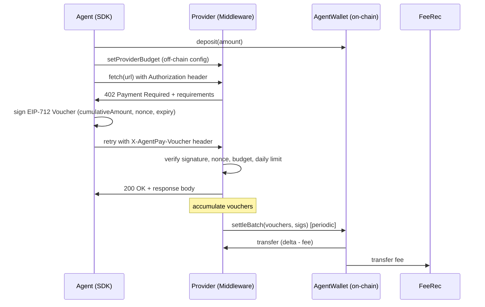

# Sluice AgentPay Core — Architecture

## Overview

AgentPay Core is a protocol-layer payment system for AI agents. It enables pay-per-call API pricing without an on-chain transaction per call. Providers serve requests, agents sign off-chain EIP-712 vouchers, and settlement happens on-chain in batches.



## Components

### Contracts (`contracts/`)

| Contract | Role |
|---|---|
| `AgentWalletFactory` | CREATE2 deployer. Maps owners to wallets. Governs protocol fee. |
| `AgentWallet` | Per-agent USDC custodian. Budget enforcement. Voucher settlement. |

**AgentWalletFactory** is the protocol singleton deployed once per chain. It snapshots `feeBps` and `feeRecipient` at wallet creation time, so protocol fee changes never affect existing agents.

**AgentWallet** (one per agent) holds:
- **Deposits** — USDC pulled from owner's wallet.
- **Budgets** — per-provider maximum cumulative payout and per-call cap.
- **Settlements** — EIP-712 vouchers verified on-chain; delta paid to provider minus fee.
- **Safety windows** — budget decreases, signer rotations, and pause withdrawals all use `settleWindow` to protect in-flight vouchers.

### SDK (`packages/sdk`)

TypeScript client library for agent developers.

- `AgentPayClient.fetch(url, init)` — drop-in `fetch` replacement. Handles 402 → sign → retry transparently.
- Off-chain state store (memory / file / Redis) tracks cumulative amounts and nonces per provider.
- Idempotency: same logical request → same voucher resent on network retry.

### Middleware (`packages/middleware`)

Express / Hono / Fastify adapter for API providers.

- Inspects incoming requests for `X-AgentPay-Voucher` header.
- Returns `402` with machine-readable JSON requirements on first call.
- Verifies voucher off-chain: signature, expiry, nonce monotonicity, budget via cached RPC.
- Persists latest voucher per wallet to SQLite / Postgres.
- Background settler: batches vouchers and calls `settleBatch()` at configurable threshold / interval.

### Indexer (`apps/indexer`)

Indexes `WalletCreated`, `Deposited`, `Settled` and related events into Postgres. Reorg-safe (uses confirmation depth). Exposes REST API consumed by the dashboard.

### Dashboard (`apps/dashboard`)

Next.js app with two roles:
- **Agent owner** — balance, budgets, deposit/withdraw, pause, rotate signer, CSV export.
- **Provider** — revenue, unsettled exposure, settlement history, integration snippet.

## Key Design Decisions

See `docs/DECISIONS.md` for the full rationale behind each tradeoff.

## Data Flow

```
[Agent process]
  └─ AgentPayClient
       ├─ Store (nonce / cumulative state)
       └─ Signer (KMS / raw key)
            │
            │ HTTP + X-AgentPay-Voucher
            ▼
[Provider process]
  └─ agentpay() middleware
       ├─ Verifier (sig, nonce, budget cache)
       ├─ VoucherStore (SQLite / Postgres)
       └─ Settler worker
            │
            │ settleBatch()
            ▼
[AgentWallet contract]
  └─ USDC transfers to provider + feeRecipient
```

## Security Properties

1. **Signer segregation** — `agentSigner` can only sign vouchers, never move funds directly.
2. **Budget caps** — provider can never extract more than `maxTotal` without owner action.
3. **Timelock decreases** — budget reductions have a `settleWindow` delay, protecting providers with outstanding vouchers.
4. **Nonce monotonicity** — replay and reordering are impossible per provider.
5. **Pause withdrawal cooldown** — pausing starts a `settleWindow` clock before the owner can withdraw, even if unpaused immediately.
6. **CEI pattern** — all state changes happen before external calls in `_settle`.
7. **No admin backdoors** — factory owner can only change protocol fees (for new wallets) and the fee recipient. It cannot touch any wallet's funds.

See `docs/THREAT_MODEL.md` for the full threat analysis.
