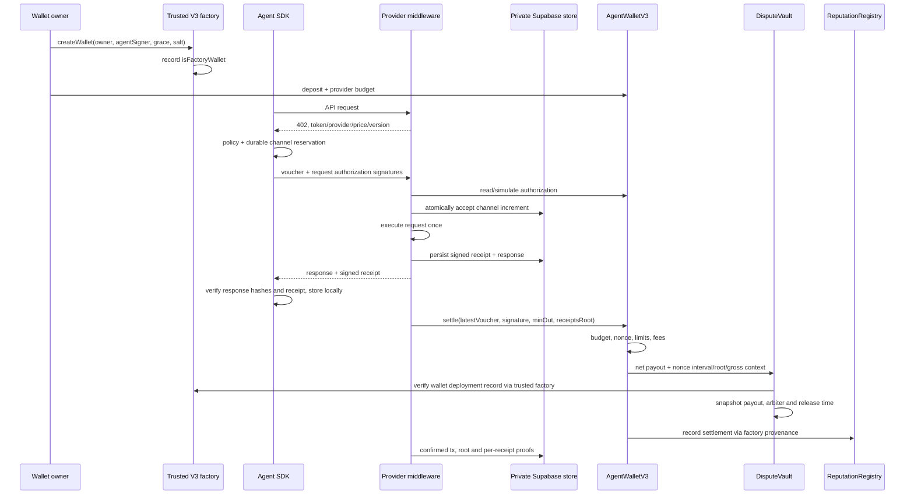

# Implemented Phase 3 architecture

The following extends ARCHITECTURE.md. V1/V2 contracts remain separate. SDK and middleware are local workspaces in backend/packages; storage uses the user's Supabase project, not SQLite.



Window zero routes directly to the provider's payout address, retaining V2 behavior. A root is optional at settlement, but a proved receipt claim requires a nonzero stored root and provider signature. No-receipt claims remain explicitly unverified bonded claims. Swapped payouts keep payment-token/gross context so a receipt's refund cap is proportional to the actual held token payout.

```mermaid
sequenceDiagram
    participant O as Current wallet owner
    participant DB as Private receipt/evidence API
    participant V as DisputeVault
    participant P as Provider
    participant A as Snapshotted arbiter
    O->>DB: SIWE session, get receipt/proof
    O->>V: approve bond, open proved or no-receipt dispute
    V->>V: freeze disputed amount + bond
    Note over V: Undisputed remainder may release once after original hold
    alt Provider concedes
        P->>V: acceptDispute
        V-->>O: disputed token refund to agent wallet, bond to opener
    else Provider silent at response deadline
        O->>V: autoRefund
        V-->>O: refund + bond
    else Provider responds before deadline
        P->>DB: private evidence / content hash
        P->>V: respondToDispute(evidenceHash)
        alt Arbiter decides before its deadline
            A->>V: split disputed amount
            V-->>O: refund to wallet; any agent win returns bond
            V-->>P: remaining provider share
        else Arbiter timeout
            O->>V: arbiterTimeout
            V-->>O: disputed refund + bond
        end
    end
```

Authority is explicit: factory registration does not grant a wallet arbitrary reputation writes. Automatic wallet callers may record only their own actual settlements through immutable wallet code. Dispute counters/outcomes remain limited to separately trusted protocol callers (the vault). Only known factory records, not a self-reported factory address, establish provenance. AgentRegistry additionally scans a bounded set of 32 trusted factories for V1 wallets without a factory getter.

The API handles reads, SIWE sessions, authorization queues and private evidence/receipts. It does not hold owner/provider signing keys or submit user transactions. Browser actions use injected-wallet signing, simulate before requesting a transaction and wait for confirmation. Local agent stores preserve issued authorizations; provider stores preserve the exact-price channel head before execution. A signature is not a reservation and neither HTTP intake nor a healthy API guarantees future settlement.

See INTEGRATION.md for wire hashes/typed-data domains and RUNBOOK.md for failure recovery. Deployment manifests distinguish real Arc transactions from local Anvil time-travel tests. Real deadline scenarios remain pending until actual chain time permits them.
